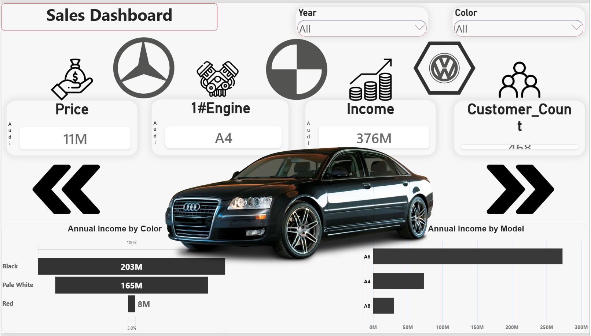
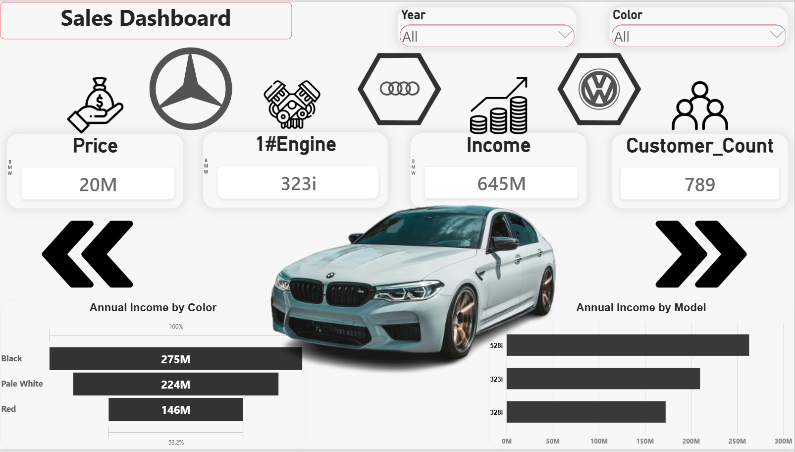
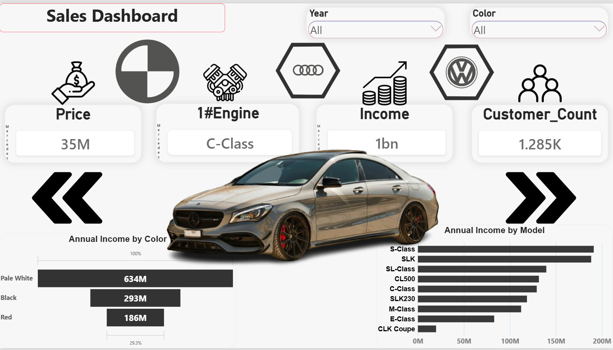
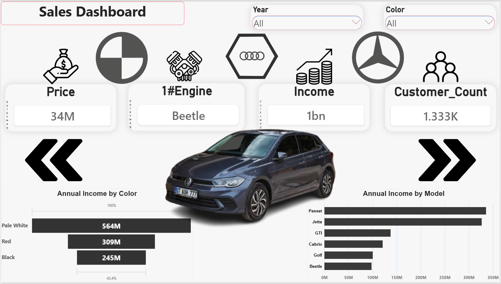

# Car Sales Dashboard (Power BI)

An interactive Power BI dashboard that gives a car dealership a one-page view of income, customers, and pricing for each brand (Audi, BMW, Mercedes, Volkswagen).

## The Problem
Sales data for several car brands was scattered, with no quick way to answer: which model brings the highest income, which color is most in demand, and what are the total income, customer count, and car price for each brand.

## The Solution
A multi-page interactive dashboard, one page per brand, with KPI cards, income charts, filters, and navigation between brands.

## Dashboard Components
- KPI cards: average price, top engine/model, total income, customer count
- Annual Income by Color chart
- Annual Income by Model chart
- Filters (Slicers): Year and Color
- Navigation between brands using arrow buttons and brand icons, with the car image changing per brand

## Screenshots

### Audi

### BMW

### Mercedes

### Volkswagen

## Example: Audi Page
- Total income: 376M, customers: 468
- Black is the highest-income color (203M), followed by Pale White (165M) and Red (8M)
- A6 is the highest-income model, followed by A4 and A8

## How It Was Built
1. Data cleaning and preparation in Power Query
2. Data model design
3. DAX measures for income and customer count
4. Interface design with icons and car images
5. Bookmarks, Buttons, and Slicers for navigation and interactivity

## Tools
Power BI: Power Query, Data Model, DAX, Bookmarks, Buttons, Slicers

## Repository Contents
- Car_Sales_Dashboard.pbix: the Power BI dashboard file
- screenshots/: dashboard previews for each brand (Audi, BMW, Mercedes, Volkswagen)
